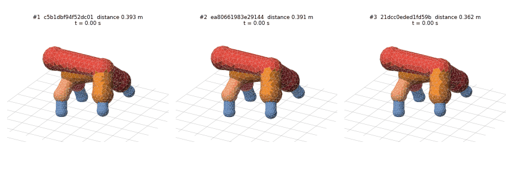
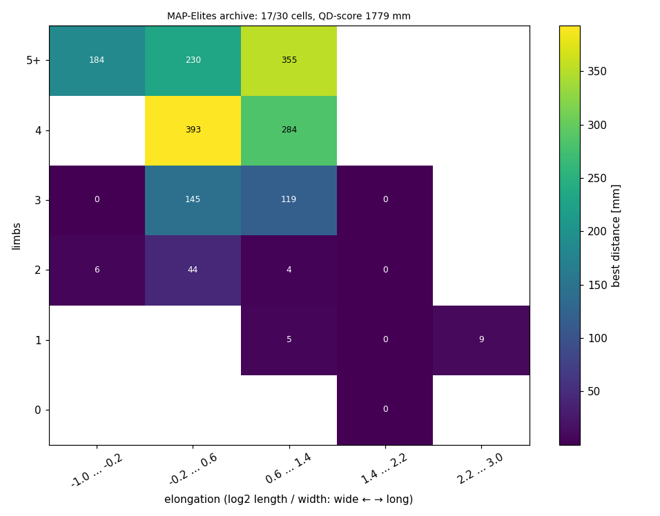

# Squishlings

Evolve soft creatures that crawl. Squishlings grows bodies out of one-centimetre cubes of real silicones
(Ecoflex 00-30, Dragon Skin 10), gives them muscles that pulse on oscillators, and lets evolution find the ones that
travel furthest. The idea is the one [Framsticks](https://www.framsticks.com/) made famous with stick creatures;
here every creature is a soft solid, simulated with [softsim](https://github.com/BoredAmi/softsim)'s material cards on
MuJoCo flex.


*The three best creatures of the first run (2³ mesh cubes per voxel). Grey: Ecoflex 00-30, blue: Dragon Skin 10,
reds and oranges: the four muscle groups. Each travels 0.5-0.6 m in 2.7 s.*

## Quick start

```bash
pip install -e .                                   # needs softsim >= 0.2.0 (voxel bodies and muscles)
squishlings creatures                              # the packaged seeds and champions
softsim run sq  uishlings/creatures/champion_1.yaml  # run one; any softsim command works on a creature
squishlings evolve jobs/crawler_fine.yaml --jobs 6                    # evolve (~4 min a generation, resumable)
squishlings evolve jobs/crawler_fine.yaml --check 3                   # exploit check of the 3 best
squishlings replay runs/crawler_fine --best 3 --gif crawlers.gif --html crawlers.html
```

The HTML replay is one self-contained page: open it in a browser, orbit the camera, pick a creature, scrub through
time. Muscles brighten as they contract.

## How a creature is made

- **Body:** a grid of up to 6 × 6 × 4 cells. Each cell is empty, a tissue (`a`, `b`: material cards) or a muscle
  group (`1`-`4`). It becomes a softsim `voxels` body; every label is a material zone. Cubes are bonded through their
  faces, and only the largest connected part survives, standing on the ground.
- **Muscles:** softsim's `type: muscle` actuator, an active stress along a fibre (x, y or z) or isotropic, driven by
  `amplitude · sin(2π f t + phase)`. Each group has its own phase and direction. Frequency (1-12 Hz) and amplitude
  (5-40 kPa) are shared by the creature and evolve too. The muscle is an effective model: no real device produces a
  volumetric stress. It is the standard abstraction of evolved soft robots. To build a creature, replace each group
  with a pneumatic chamber or a cable that gives the same strain; softsim validates both.
- **Evolution:** a (μ+λ) strategy. Tournament selection, one-cut crossover, mutation of cells, phases, directions and
  scalars; the best of parents and children survive, so the champion is never lost. Hand-made creatures can seed the
  first population. Every simulation is cached in `evaluations.jsonl`: a run is deterministic for a seed, and a
  stopped run resumes without re-simulating (a laptop shutdown cost one generation).
- **Fitness:** the planar distance the centre of mass travels after 0.3 s of settling, in 3 s on MuJoCo. Any metric of
  the `locomotion` scenario can serve: `distance_x`, `mean_speed`, `path_length`, `max_tilt`, `turn`, `flipped`.

## How far to trust a distance

Evolution finds whatever moves the creature, including numerical artefacts. `--check` re-runs the champions with
each cube split into 2³, half the time step, and friction ×0.8 and ×1.2, and flags any gait whose distance moves by
more than 25%. What it found on the first runs (2026-11-17, laptop, 6 workers):

| Run | Creatures | Distance as evolved | One mesh level finer | Time step / 2 | Friction ±20% |
|---|---|---|---|---|---|
| `crawler.yaml`, 1 cube per voxel, 30 generations | 744 | 882 / 822 / 817 mm | −45% / −45% / −80% | +2-4%, −6% | under 9% |
| `crawler_fine.yaml`, 2³ per voxel, 12 generations | 208 | 683 / 672 / 667 mm | −17% / −13% / −26% (3³) | | |

The gaits hop more than they slide, so friction barely matters. The mesh does: MuJoCo's linear tetrahedra are too
stiff in bending, and a one-cube limb is six of them, so the coarse run evolved creatures that rely on stiff legs.
Evolving at 2³ halves the error, and its winners beat the coarse winners at 3³ too (569-585 against 333-360 mm).
**Distances rank creatures at the run's resolution; they are not converged speeds.** Evolve with `subdivide: 2` and
check the winners one level finer.

Two more effects of the numerics:

- **Friction:** MuJoCo uses the larger of the two friction coefficients in a contact, and the silicone cards say 1.0, so
  a ground friction of 0.8 alone does nothing. Squishlings writes one friction (`genome.friction`, default the
  ground's) into the ground, the body and every zone.
- **Symmetry:** the six tetrahedra of each cube are not mirror symmetric, so a symmetric body drifts sideways (the
  inchworm about 1 mm per 5 mm forward).

Also: on MuJoCo every run prints "Flex stiffness is too ill-conditioned" and "Inertia matrix is too close to
singular" warnings, nearly all on the first time step, where the solver starts from rest with nothing to warm-start
from. They do not affect the results (no run failed, replays reproduce the evolved distances exactly).

## Soft sticks (prototype)

A second body encoding, closer to Framsticks: the body is a tree of soft capsules joined end to end, written as
indented text. This champion has a torso, two mirrored leg pairs, and a tail:

```text
seg len=29.5 r=6 mat=a muscle=2 bend
  seg len=14 r=5.4 mat=a yaw=-60 pitch=-40 muscle=1 bend roll=90 sym
    seg len=9 r=3 mat=b pitch=-13
  seg len=20 r=5.5 mat=a yaw=-180 pitch=-20 muscle=2
    seg len=12.4 r=4 mat=a yaw=-60 pitch=-40 muscle=1 sym
      seg len=9 r=3 mat=b pitch=-30
---
freq=6.95 amp=15000 phases=1.500,4.843,3.964,6.030
```



*The three best creatures of the first soft-stick run. Reds and oranges: Ecoflex 00-30 muscles (every Ecoflex
segment of these champions evolved into one; the two halves of a bending muscle are lighter and darker), blue:
passive Dragon Skin 10 feet. Each travels 360-390 mm in 2.7 s.*

How the encoding works:

- **Segments:** each segment has a length, a radius, a tissue and a direction relative to its parent (`yaw`,
  `pitch`). It can also have a muscle group, which either contracts along its axis or, with `bend`, is split
  lengthwise into two halves driven in antiphase so it curls (`roll` sets the bend plane). `sym` adds a mirrored
  copy of the subtree. A body has at most 10 segments.
- **Mesh:** gmsh fuses the cylinders and the joint spheres into one solid, trims it flat 1.5 mm above its lowest
  point (round bodies roll over otherwise), and meshes it at 3 mm. Each tet is labelled by the capsule it lies in,
  and the result is a softsim `mesh_file` body.
- **Evolution:** (μ+λ) as for voxels. Mutation steps a number, adds, deletes or copies a subtree, or toggles a
  muscle, `bend` or `sym`. Crossover swaps subtrees. The text is the genome, so a language model can edit it
  directly; that is the next step.

```bash
squishlings evolve jobs/sticks.yaml --jobs 8             # resumable, like the voxel jobs
squishlings evolve jobs/sticks.yaml --check 3 --jobs 8   # exploit check: mesh x2/3, time step / 2, friction ±20%
squishlings replay runs/sticks --best 3 --gif sticks.gif --html sticks.html
```

**First run** (2026-11-18, 20 generations, 336 creatures, 5.7 h on 8 laptop cores, no failures): the best distance
rose from 33 mm to 393 mm in 2.7 s of gait. Exploit check of the top 3:

| Creature | Distance as evolved | Mesh 3 → 2 mm | Time step / 2 | Friction ×0.8 | Friction ×1.2 |
| --- | --- | --- | --- | --- | --- |
| `champion_1` | 393 mm | +2% | +4% | −16% | +6% |
| `champion_2` | 391 mm | +10% | −2% | −16% | +12% |
| `champion_3` | 362 mm | +11% | −1% | −16% | +14% |

- **The mesh matters much less than for voxels:** +2% to +11% one step finer, against −13% to −26% for 2³ voxels.
  The step is smaller, though (1.7× the tets, against 3.4×), and the distances still grow, so the coarse mesh is
  slightly too stiff. Creatures within about 10% of each other do not rank reliably.
- **These gaits crawl rather than hop,** so friction matters more than it does for the voxel gaits.
- **Voxels still go further:** 400-430 mm for sticks against 569-585 mm for voxels, both on the finer mesh. The
  voxels had 42 generations and muscles up to 40 kPa, and the stick champion sits at its 15 kPa limit.

The design, the problems found while building it, and the results are in
[docs/design/soft-sticks.md](docs/design/soft-sticks.md).

## MAP-Elites

A (μ+λ) run converges on one body plan. In the first soft-stick run, 139 of the 336 creatures were four-legged
descendants of the same seed. MAP-Elites ([Mouret & Clune 2015](https://arxiv.org/abs/1504.04909)) keeps the
fastest creature of each kind of body instead. Each creature gets descriptors computed from its genome (for
sticks: `limbs`, `segments`, `elongation`, `height`; for voxels: `cells`, `elongation`, `height`). They place it
in one cell of a grid, the archive, and it takes the cell if the cell is empty or it is faster than the creature
there. Parents are drawn uniformly from the occupied cells, so every kind of body keeps improving, and no kind
can take over.



*The first (μ+λ) soft-stick run seen as an archive: 17 of the 30 cells visited, and nearly every improvement
in the four-legged and 5+ limb cells. Cells visited once by a random creature never improve.*

```bash
squishlings evolve jobs/sticks_map.yaml --jobs 8            # 640 simulations, ~8 h; resumable
squishlings evolve jobs/sticks_map.yaml --check 3 --jobs 8
squishlings replay runs/sticks_map --best 4 --gif map.gif   # the fittest elites, one per kind
```

To use it in a job, set `evolution: {method: map_elites, ...}` and add an `archive:` block (descriptors, bins,
ranges). Each run writes:

- `archive.png`: the best distance in each cell;
- `elites/`: every elite as a scenario that runs in softsim;
- the archive in `report.yaml`, with its coverage (share of cells filled) and QD-score (the sum of the elites'
  distances: one number for quality and diversity together).

The same idea, with a language model as the mutation operator, is the setup of *Evolution through Large Models*
(Lehman et al. 2022).

## Files

| | |
|---|---|
| `squishlings/genome.py` | the encoding and its operators (mutation, crossover, repair) |
| `squishlings/build.py` | genome ↔ softsim scenario |
| `squishlings/evolve.py` | the evolution loop and the exploit check |
| `squishlings/locomotion.py` | the `locomotion` scenario (registered with softsim as `scenario: locomotion`) |
| `squishlings/map_elites.py` | MAP-Elites: descriptors, the archive, its heatmap |
| `squishlings/replay.py` | GIF and HTML replays |
| `squishlings/creatures/` | `base.yaml` (shared settings), seeds (`inchworm`, `quad`), the first run's champions |
| `jobs/` | `crawler.yaml` (fast, exploratory), `crawler_fine.yaml` (recommended), `sticks.yaml` (soft sticks), `sticks_map.yaml` (soft sticks, MAP-Elites) |
| `squishlings/sticks.py` | soft sticks: the text genome and its operators |
| `squishlings/sticks_mesh.py` | soft sticks → gmsh mesh with muscle regions → softsim scenario |
| `squishlings/creatures/sticks/` | soft-stick seeds (`inchworm`, `walker`) and the first run's champions |
| `spikes/` | the soft-stick feasibility spike |

## Ideas

Neural controllers reading touch and strain sensors instead of open-loop oscillators (Framsticks' brains); swimming
and climbing tasks; turning muscle groups into buildable chambers and cables; a GPU backend for larger populations.

Licence: Apache-2.0.
