# Squishlings

Evolve soft creatures that crawl, and let a language model help design them. Squishlings grows bodies from real
silicones (Ecoflex 00-30, Dragon Skin 10), gives them muscles that pulse on oscillators, simulates them with
[softsim](https://github.com/BoredAmi/softsim)'s material cards on MuJoCo flex, and keeps the ones that travel
furthest. The idea is the one [Framsticks](https://www.framsticks.com/) made famous with stick creatures; here
every creature is a soft solid.


*Left: the best soft-stick creature found by MAP-Elites with random mutation (1123 mm in 2.7 s). Middle and right:
the two best when a local language model (qwen3.5:9b) writes half of the children (1618 mm, 1380 mm). Same seed,
same starting creatures, same 640 simulations.*

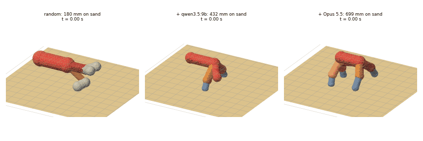

*On soft sand-like ground: the best of random evolution (180 mm), with qwen3.5:9b (432 mm) and with Claude Opus 5.5
(699 mm) writing half of the children. See [Terrain](#terrain).*

**Findings so far** (MAP-Elites, 640 creatures per run, details below):

- **A language model as a mutation operator beats random mutation alone.** On flat ground, a local 9B model raised
  the QD-score by 45% (three seeds); its champions also climb a slope far better than random ones.
- **Evolved on four grounds, the stronger model finds the best creatures, the weaker one the most kinds.** Claude
  Opus 5.5 found the best generalist (701 mm against 502 mm with qwen3.5:9b and 383 mm with random mutation) and
  the best specialist on every ground. qwen3.5:9b filled the archives better (QD-score 5.3 against 4.1 and 3.2).
  Opus kept refining one four-legged design. One seed so far.
- **Every champion is checked for numerical exploits** (finer mesh, half time step, friction ±20%). Most pass.
  Those that don't are flagged in the results, Opus's best among them.

## What is in here

- **Two body encodings.** *Voxels*: a grid of 1 cm cubes of tissue and muscle. *Soft sticks*: a tree of silicone
  capsules written as indented text, meshed with gmsh: the Framsticks idea, made soft.
- **Two search methods.** A (μ+λ) evolution strategy, and MAP-Elites, which keeps the best creature of each kind
  of body instead of one ranked population.
- **A language model as a mutation operator.** The stick genome is plain text, so an LLM can read a parent and
  write an edited one ([Evolution through Large Models](https://arxiv.org/abs/2206.08896)): a local model on
  [ollama](https://ollama.com), or Claude Opus 5.5 through Claude Code.
- **Four grounds.** Flat, an 8° slope, a lattice of low ridges and soft sand-like ground. Creatures can be scored
  on the mean over all four, with one specialist archive per ground on the side.
- **An exploit check.** Evolution finds numerical artefacts as eagerly as gaits, so every champion is re-run on a
  finer mesh, with half the time step, and with friction ±20%.

## Results so far

All distances are the centre of mass travelled in 2.7 s after settling, on MuJoCo (2026-11-17 to 11-24; one PC
with 8 threads, seed 5 and the terrain runs on a second PC with 20).

| Run | Encoding, method | Simulations | Best | Exploit check |
| --- | --- | --- | --- | --- |
| `crawler_fine` | voxels, (μ+λ) | 208 | 683 mm | −13% to −26% on a finer mesh |
| `sticks` (first run) | sticks, (μ+λ), ≤ 8 Hz, ≤ 15 kPa | 336 | 393 mm | within 16% |
| `sticks` (second run) | sticks, (μ+λ), ≤ 12 Hz, ≤ 30 kPa | 496 | 1412 mm | within 9%, but it buzzes (below) |
| `sticks_map` (seeds 3, 4, 5) | sticks, MAP-Elites, random mutation | 640 each | 1123, 953, 1290 mm | champions within 5%; 2 of 9 top-3 flagged |
| `sticks_map_llm` (seeds 3, 4, 5) | sticks, MAP-Elites, random + LLM | 640 each | **1618**, **1400**, 1213 mm | champions within 23%; 1 of 9 top-3 flagged |
| `sticks_terrain` (seed 3) | sticks, MAP-Elites on 4 grounds, random | 640 × 4 | 383 mm mean | 2 of top 3 flagged |
| `sticks_terrain_llm` (seed 3) | … + qwen3.5:9b | 639 × 4 | 502 mm mean | 1 of top 3 flagged |
| `sticks_terrain_claude` (seed 3) | … + Claude Opus 5.5 | 623 × 4 | **701** mm mean | 2 of top 3 flagged; #2 (693 mm) passes |

## A language model in the loop

The question (from Prof. Jakub Bernat): can an LLM propose changes to a robot's geometry, with an evolutionary
algorithm keeping the better ones and a simulator judging them? Here is the first experiment.

**Setup.** Pairs of MAP-Elites runs, identical (seed, starting creatures, 38 batches of 16 children) except that
in `sticks_map_llm` each child has a 50% chance to be written by `qwen3.5:9b` instead of by crossover and random
mutation. The model sees the encoding rules, the parent, its distance and kind of body, and the three best other
elites, and answers with one line of reasoning and a complete new genome. Three seeds per arm.

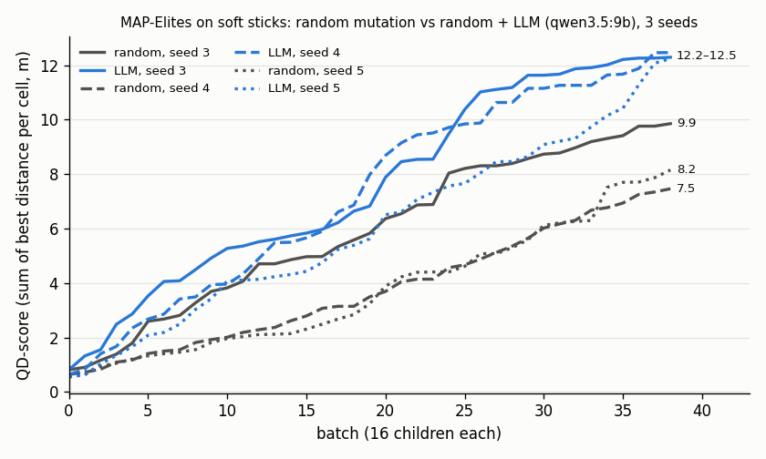

| After 640 simulations | Random mutation | Random + LLM |
| --- | --- | --- |
| QD-score (sum of the elites' distances), seeds 3 / 4 / 5 | 9.85 / 7.46 / 8.15 m | **12.29 / 12.46 / 12.24 m** |
| QD-score, mean | 8.49 m | **12.33 m (+45%)** |
| Best distance, seeds 3 / 4 / 5 | 1123 / 953 / **1290** mm | **1618 / 1400** / 1213 mm |
| Cells filled (of 30), seeds 3 / 4 / 5 | 27 / 25 / 27 | 27 / 26 / 27 |

**The LLM wins on quality-diversity in every seed** (+25%, +67%, +50%) and lands in the same place each time
(12.2–12.5 m), while random mutation spreads from 7.5 to 9.9 m. The single best creature is better with the LLM in
two seeds of three: seed 5's random run found a 1290 mm walker. So the claim is "more good bodies of more
kinds", not "always a faster champion". All six champions pass the exploit check. Among the top three of each
run, one of nine LLM creatures is flagged (+51% with half the time step, seed 3) and two of nine random ones
(−78% under one variant in seed 4, +33% on a finer mesh in seed 5).

**The model is a reliable operator.** Over the three seeds it wrote 880 children: 27 answers did not parse (it
wrote `1.2+pi` as a phase, for example) and 5 changed nothing; those fell back to random mutation. 165 of its
children (19%) entered the archive. A 9B model on an RTX 3060 answers in about 7 s, while the simulations of a
batch take 12 minutes, so the model costs almost nothing.

**It makes the big jumps; random mutation tunes them.** The seed 3 champion's lineage:

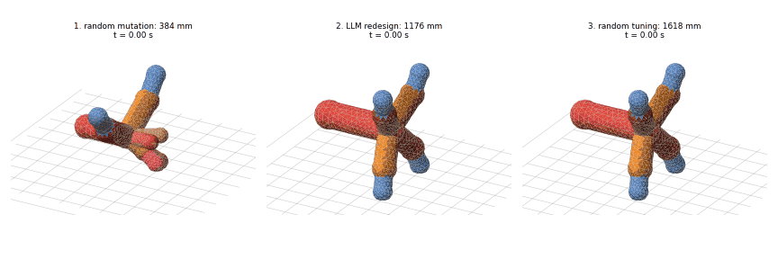

1. 384 mm, made by random mutation;
2. **1176 mm, the model's redesign** (×3): *"The parent robot has 6 limbs but only utilizes muscle groups 1 and 3
   effectively… I will remove the two short, stiff 'foot' segments…"*;
3. 1618 mm, random mutation tuning the redesign.


*The same creatures as at the top, 0.4 s of gait in 10× slow motion. At 10-12 Hz the normal-speed GIFs cannot
show a stride; this one can.*

The other two seeds. Seed 4, where the LLM's lead is largest:

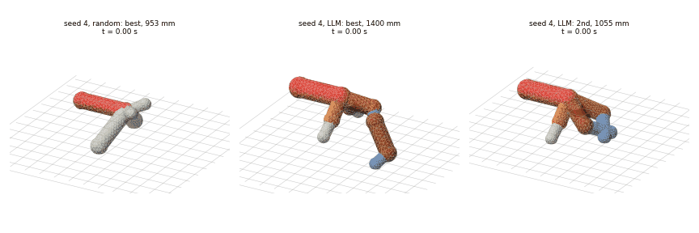

Seed 5, where random mutation found the faster champion. The LLM's two best are close relatives that landed in
neighbouring cells (5+ and 4 limbs):

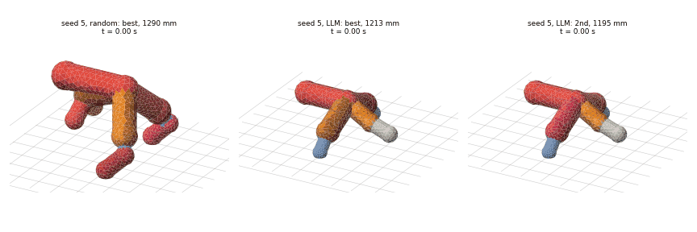

Quality-diversity in one run: the best 2-, 3-, 4- and 6-limbed creatures of seed 4 with the LLM, each a different
body plan that walks:

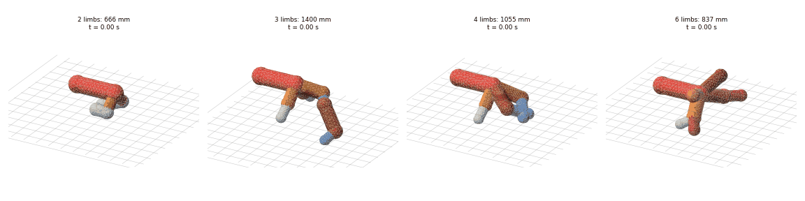

| Random mutation | Random + LLM |
| --- | --- |
| 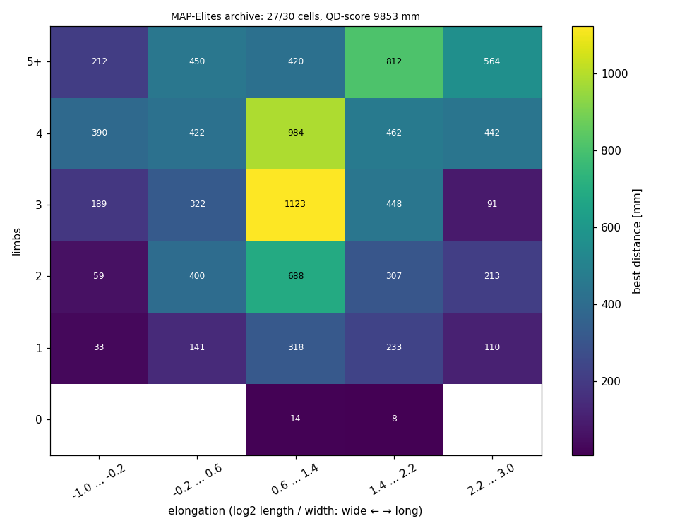 |  |

**How far this goes.** Three seeds per arm, one task, one encoding, one model: consistent, but small. The
champions sit at the muscle limits (12 Hz, 30 kPa), and the model can only edit what the encoding can say.

```bash
ollama pull qwen3.5:9b
squishlings evolve jobs/sticks_map_llm.yaml --jobs 8   # ~9 h; resumable, every answer cached in llm.jsonl
```

In a job, set `evolution: {method: map_elites, ..., llm: {model: "qwen3.5:9b", rate: 0.5, examples: 3}}`.

## Terrain

Every creature above was evolved on one flat, rigid plane. `squishlings terrain` re-runs finished runs' best
creatures on three harder grounds (`squishlings/terrain.py`; softsim 0.2.0's ground obstacles and compliance):

- **slope:** 8°, climbed uphill along the creature's own heading on flat ground (sliding back scores negative);
- **ridges:** a lattice of 3 mm high, 6 mm wide ridges every 40 mm in x and y, the start left clear;
- **sand:** a soft, damped ground (contact time constant 20 ms: a resting block sinks about 3 mm). This is soft
  contact, not granular physics: no grains, no displaced material.

The top 3 of each flat MAP-Elites run (9 per arm), as % of each creature's own flat distance (averages):

| Arm | Slope | Ridges | Sand | Mean distance over the 4 grounds |
| --- | --- | --- | --- | --- |
| random | 42% | 51% | 27% | 512 mm |
| random + LLM | **76%** | 49% | 35% | **786 mm** |

Three of the nine random champions slide backwards on the slope; every LLM champion keeps climbing (59–104%).
Ridges are a tie, and sand varies from 5% to 104% in both arms. One LLM creature (seed 3, #2) keeps about 100% on
every ground. These are 9 creatures per arm, and the creatures of one run are not independent. Per creature:
`runs/*/terrain.yaml`.

### Evolved on all four grounds: random, qwen, Claude Opus 5.5

`jobs/sticks_terrain*.yaml` score each creature on its mean distance over flat, slope, ridges and sand
(`terrains:`, `fitness: {metric: terrain_mean}`). With `archive: {per_terrain: true}` they also keep a specialist
archive per ground beside the generalists, from the same simulations. Three arms, all seed 3 with the same
starting creatures and about 630 creatures × 4 simulations each (2026-11-21 to 11-24, 20 threads):

- **random:** random mutation and crossover only;
- **+ qwen3.5:9b:** the local model writes half of the children, as above. The prompt says what the creatures
  are scored on;
- **+ Claude Opus 5.5:** the same prompt and rate, answered by Claude Opus 5.5 through headless Claude Code
  (`tools/claude_bridge.py`: an ollama-compatible endpoint, no tools, no project files, Claude Code's own system
  prompt replaced by ours). 298 answers, every one parsed, about 8 s each. Claude Code reported $8.18, the API
  price of these calls; we ran them on a Pro plan.

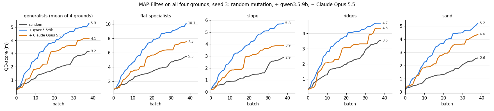

| | random | + qwen3.5:9b | + Claude Opus 5.5 |
| --- | --- | --- | --- |
| best generalist (mean of 4 grounds) | 383 mm | 502 mm | **701 mm** (693 mm passes the check) |
| its flat / slope / ridges / sand | 637 / 342 / 419 / 135 | 682 / 560 / 530 / 234 | 910 / 670 / 770 / 455 |
| best specialist: flat / slope / ridges / sand | 637 / 469 / 419 / 180 | 1020 / 672 / 531 / 432 | **1123 / 852 / 809 / 699** |
| generalist archive: coverage, QD-score | **90%**, 3.2 | 87%, **5.3** | 80%, 4.1 |
| specialist QD-score: flat / slope / ridges / sand | 5.5 / 2.9 / 3.5 / 2.6 | **10.1 / 5.8 / 4.7 / 5.2** | 7.5 / 3.9 / 4.3 / 4.4 |
| LLM children into the archive | | 42 of 275 | 19 of 297 |
| archive cells descended from an LLM child | | 21 of 26 | 7 of 24 |

Both models beat random mutation everywhere. The two differ in a clear way:

- **Opus finds the best creatures** on every ground: the best generalist (+40% over qwen) and the best specialist
  of each ground, sand most of all (699 mm against 432 mm). All of them descend from its children.
- **qwen fills the archive better.** It has the higher QD-score in all five archives, and its children and their
  descendants hold 21 of 26 cells. Opus's hold 7 of 24.
- Opus converges. Its "Idea:" lines keep returning to one design: a symmetric four-legged body with bending legs
  ("so the body matches the 700 mm design", copying an example from the prompt). Those cells (3–4 limbs, compact)
  reach 400–700 mm while the rest of the archive stays near random's. qwen's edits are less coherent but more
  varied.

**The exploit check is less kind to the Opus generalists.** Its #1 loses 30% with friction 0.8. #2 (693 mm) stays
within 22% on every variant, but it loses about 22% on the finer mesh and on half the time step, so part of its
lead may be numerical. The qwen #1 (502 mm) and the random #1 (383 mm) pass.

One seed per arm, so this is a first look, not a result. The QD-score gap between qwen and Opus is about as large
(about 25%) as the spread between the random seeds in the flat runs. The best-creature gap is larger.

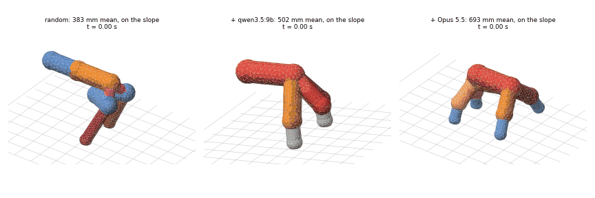

*The best robust generalist of each arm, on the slope: random (383 mm mean over the four grounds), + qwen3.5:9b
(502 mm), + Opus 5.5 #2 (693 mm).*

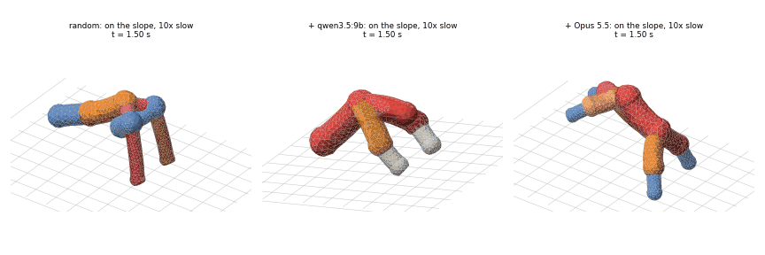

*The same three on the slope, 0.4 s (1.5–1.9 s) in 10× slow motion: three different body plans and gaits.*

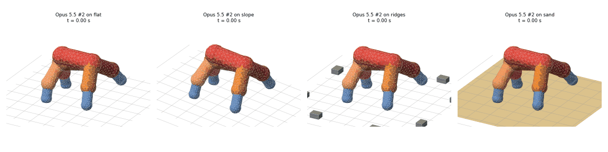

*One generalist, four grounds: Opus 5.5 #2 on flat ground, the slope, the ridges and the sand.*

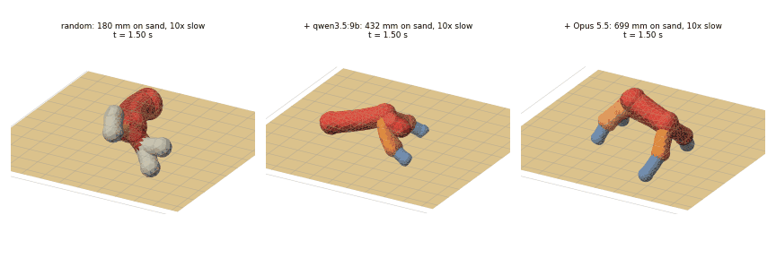

*The best sand specialist of each arm in 10× slow motion. Sand is where the arms differ most: random 180 mm,
qwen3.5:9b 432 mm, Opus 5.5 699 mm.*

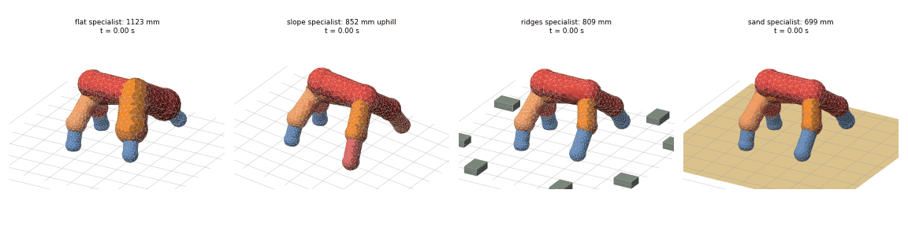

*The Opus 5.5 run's best specialist for each ground, found by the same simulations as the generalists: flat
1123 mm, slope 852 mm uphill, ridges 809 mm, sand 699 mm. All four are variations of the same four-legged body,
which is the convergence described above.*

The GIFs are replays with each mesh rebuilt from the genome, because the runs' meshes stayed on the other PC. Flat
runs reproduce, but a creature's path on ridges or the slope can differ from the run; the distances quoted are the
runs'.

To run the Opus arm: `python3 tools/claude_bridge.py --model opus --port 11500`, then
`squishlings evolve jobs/sticks_terrain_claude.yaml --jobs 16`. The bridge waits out usage limits instead of
failing, because `llm.py` falls back to random mutation on an error. It is a stand-in for the API (no seed, no
temperature), so answers can't be reproduced, but every one is cached in `llm.jsonl`.

## Quick start

```bash
pip install -e .                                    # needs softsim >= 0.2.0 (voxels, muscles, terrain), gmsh
squishlings creatures                               # the packaged seeds and champions
softsim run squishlings/creatures/champion_1.yaml   # run one; any softsim command works on a creature
squishlings evolve jobs/sticks_map.yaml --jobs 8    # evolve (resumable)
squishlings evolve jobs/sticks_map.yaml --check 3 --jobs 8   # exploit check of the 3 best
squishlings replay runs/sticks_map --best 3 --gif best.gif --html best.html
squishlings terrain runs/sticks_map --top 3 --jobs 8         # the best 3 on slope, ridges and sand
squishlings replay runs/sticks_map --best 1 --terrain ridges --gif ridges.gif
```

If `squishlings` is installed in softsim's virtual environment, activate it first
(`source ../softsim/.venv/bin/activate`). The HTML replay is one self-contained page: orbit the camera, pick a
creature, scrub through time; muscles brighten as they contract.

## Soft sticks

A body is a tree of soft capsules joined end to end, written as indented text, plus a footer for the muscles.
This is the LLM run's champion:

```text
seg len=30 r=6 mat=a muscle=2
  seg len=18 r=5 mat=a yaw=-70 pitch=-45 muscle=1 bend roll=90 sym
    seg len=10 r=4 mat=b pitch=-20
  seg len=18 r=5 mat=a yaw=70 pitch=45 muscle=4 bend roll=-90 sym
    seg len=10 r=4 mat=b pitch=20
---
freq=12 amp=30000 phases=3.192,6.155,2.465,3.077
```

- **Segments:** a length and a radius (mm), a tissue (`a`: Ecoflex 00-30, `b`: Dragon Skin 10), and a direction
  relative to the parent (`yaw`, `pitch`). A child grows from its parent's far end. `sym` adds a mirrored copy of
  the subtree. At most 10 segments.
- **Muscles:** `muscle=g` makes a segment group `g`, contracting along its axis with
  `amp · sin(2π · freq · t + phase_g)`. With `bend` the segment is split lengthwise into two halves driven in
  antiphase, so it curls (`roll` turns the plane it curls in).
- **Mesh:** gmsh fuses the cylinders and the joint spheres into one solid, trims it flat 1.5 mm above its lowest
  point (round bodies roll over otherwise), and meshes it at 3 mm. Each tet is labelled by the capsule it lies in,
  and the result is a softsim `mesh_file` body.
- **Operators:** mutation steps a number, adds, deletes or copies a subtree, or toggles a muscle, `bend` or `sym`;
  crossover swaps subtrees. Every genome, including a language model's, goes through `repair`, which clamps each
  value to its range and prunes the tree to the limits, so anything that parses can be simulated.

**Colours in the GIFs:** blue: passive Dragon Skin 10 (the feet), grey: passive Ecoflex 00-30, reds and oranges:
Ecoflex muscles, one shade per segment; the two halves of a bending muscle are lighter and darker.

## Voxels

The first encoding: a grid of up to 6 × 6 × 4 one-centimetre cells, each empty, a tissue or one of four muscle
groups, built as a softsim `voxels` body. Muscles are an active stress along x, y or z, or isotropic.

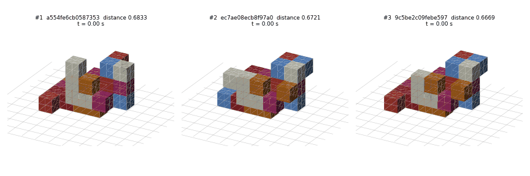

*The three best voxel creatures (2³ mesh cubes per voxel). Grey: Ecoflex 00-30, blue: Dragon Skin 10, reds and
oranges: the four muscle groups. 0.5-0.6 m in 2.7 s.*

The muscle is an effective model: no real device produces a volumetric stress. It is the standard abstraction
of evolved soft robots; to build a creature, replace each group with a pneumatic chamber or a cable that gives the
same strain (softsim validates both).

## Search

- **(μ+λ):** tournament selection, crossover and mutation; the best of parents and children survive, so the
  champion is never lost. It converges on one body plan: in the first stick run, 139 of 336 creatures were
  four-legged descendants of the same seed.
- **MAP-Elites** ([Mouret & Clune 2015](https://arxiv.org/abs/1504.04909)): each creature gets descriptors computed
  from its genome (sticks: `limbs`, `segments`, `elongation`, `height`; voxels: `cells`, `elongation`, `height`),
  which place it in a cell of a grid. It takes the cell if the cell is empty or it beats the creature there.
  Parents are drawn uniformly from the occupied cells, so every kind of body keeps improving. In the random-mutation
  run this kept the inchworm lineage alive, which then became the best three- and four-limbed creatures; in the
  (μ+λ) run it died out in the first generations.
- **Fitness:** the planar distance of the centre of mass, after 0.3 s of settling. Any metric of the `locomotion`
  scenario can serve (`distance_x`, `mean_speed`, `path_length`, `max_tilt`, `turn`, `flipped`).
- **Caching:** every simulation goes into `evaluations.jsonl`, so a run is deterministic for a seed, and a stopped
  run resumes without simulating again.

Each MAP-Elites run writes `archive.png` (the best distance per cell), `elites/` (each elite as a runnable softsim
scenario), and the archive in `report.yaml` with its coverage and QD-score.

## How far to trust a distance

Evolution finds whatever moves the creature, including numerical artefacts. What we have found so far:

- **Mesh resolution (voxels):** MuJoCo's linear tetrahedra are too stiff in bending. Voxel champions evolved on
  one cube per voxel lost 45-80% on a finer mesh, and those evolved on 2³ lost 13-26%. Stick champions change by
  0-11% from a 3 mm to a 2 mm mesh. **Distances rank creatures at the run's resolution; they are not converged
  speeds.**
- **Blow-ups:** one creature of the LLM run ended its run 17.6 cm in the air, flipped over, and was scored at
  2.7 m: the simulation had launched it. No other creature of about 1,400 ended above 6 cm. A creature still
  higher than `fitness.max_height` (default 10 cm) at the end now gets the worst fitness, and the report counts
  them.
- **Buzzing:** the second (μ+λ) stick run reached 1412 mm with a compact body vibrating at 12 Hz, its legs moving a
  few millimetres per stroke. It passes the numerical checks, but it is the kind of gait to distrust until the
  frequency is capped lower. The MAP-Elites champions move with large, visible strokes (see the slow-motion GIF).
- **Friction:** MuJoCo uses the larger of the two friction coefficients in a contact, so a lower ground friction
  alone does nothing. Squishlings writes one friction into the ground, the body and every zone.
- **Warnings:** every MuJoCo run prints "Flex stiffness is too ill-conditioned" and "Inertia matrix is too close
  to singular", nearly all on the first time step. They do not affect the results: replays reproduce the
  evolved distances exactly.

`--check N` re-runs the N best with a finer mesh, half the time step and friction ×0.8 and ×1.2, and flags any
whose distance moves by more than 25%.

The design notes, the spike, and the problems found while building the soft sticks are in
[docs/design/soft-sticks.md](docs/design/soft-sticks.md).

## Files

| File | What it is |
| --- | --- |
| `squishlings/sticks.py` | soft sticks: the text genome, its operators and repair |
| `squishlings/sticks_mesh.py` | soft sticks → gmsh mesh with muscle regions → softsim scenario |
| `squishlings/llm.py` | the language-model mutation operator (ollama) |
| `squishlings/terrain.py` | slope, ridges and sand: scoring a creature on them, the transfer test |
| `squishlings/map_elites.py` | MAP-Elites: descriptors, the archive, its heatmap |
| `squishlings/evolve.py` | the evolution loop ((μ+λ) and MAP-Elites) and the exploit check |
| `squishlings/genome.py`, `build.py` | voxels: the encoding, its operators, genome ↔ softsim scenario |
| `squishlings/locomotion.py` | the `locomotion` scenario (registered with softsim) |
| `squishlings/replay.py` | GIF and HTML replays |
| `tools/claude_bridge.py` | an ollama-compatible endpoint answered by headless Claude Code (the Opus arm) |
| `squishlings/creatures/` | seeds and champions: voxels (`*.yaml`), soft sticks (`sticks/*.txt`) |
| `jobs/` | `crawler*.yaml` (voxels), `sticks.yaml` ((μ+λ)), `sticks_map.yaml` (MAP-Elites), `sticks_map_llm.yaml` (MAP-Elites + LLM), `sticks_terrain*.yaml` (on all four grounds) |
| `spikes/` | the soft-stick feasibility spike |

## Next

- The terrain runs on seeds 4 and 5, so random / qwen / Opus has three seeds per arm.
- Keeping Opus from converging: ask it for a different body type than the examples, or show it empty cells.
- Voxels × {random, LLM} for the full 2 × 2 comparison.
- A lower frequency cap (about 6 Hz) to rule out buzzing gaits.
- Neural controllers reading touch and strain sensors instead of open-loop oscillators (Framsticks' brains).
- Turning muscle groups into buildable chambers and cables.

Licence: Apache-2.0.
