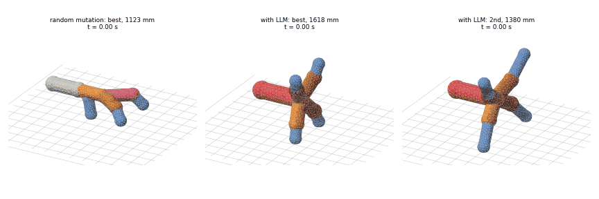
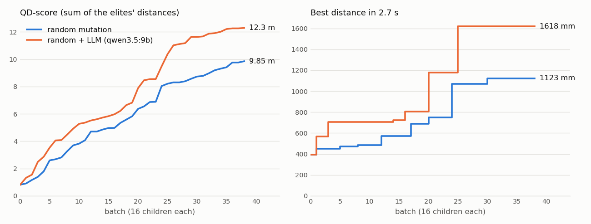
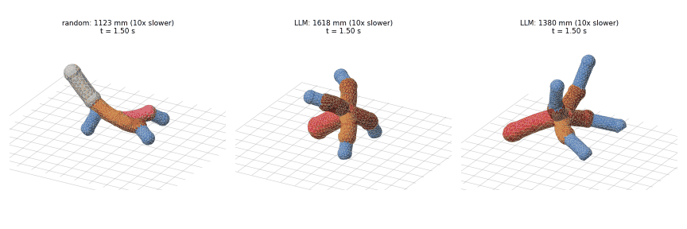
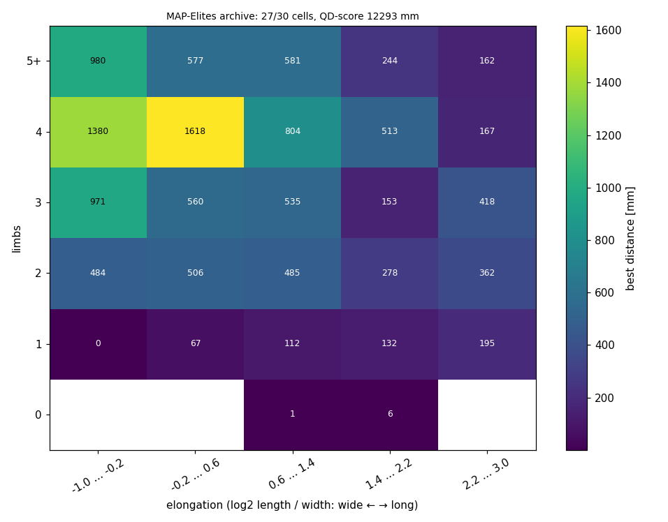

# Squishlings

Evolve soft creatures that crawl, and let a language model help design them. Squishlings grows bodies from real
silicones (Ecoflex 00-30, Dragon Skin 10), gives them muscles that pulse on oscillators, simulates them with
[softsim](https://github.com/BoredAmi/softsim)'s material cards on MuJoCo flex, and keeps the ones that travel
furthest. The idea is the one [Framsticks](https://www.framsticks.com/) made famous with stick creatures; here
every creature is a soft solid.



*Left: the best soft-stick creature found by MAP-Elites with random mutation (1123 mm in 2.7 s). Middle and right:
the two best when a local language model (qwen3.5:9b) writes half of the children (1618 mm, 1380 mm). Same seed,
same starting creatures, same 640 simulations.*

## What is in here

- **Two body encodings.** *Voxels*: a grid of 1 cm cubes of tissue and muscle. *Soft sticks*: a tree of silicone
  capsules written as indented text, meshed with gmsh: the Framsticks idea, made soft.
- **Two search methods.** A (μ+λ) evolution strategy, and MAP-Elites, which keeps the best creature of each kind
  of body instead of one ranked population.
- **A language model as a mutation operator.** The stick genome is plain text, so an LLM can read a parent and
  write an edited one ([Evolution through Large Models](https://arxiv.org/abs/2206.08896), run offline on
  [ollama](https://ollama.com)).
- **An exploit check.** Evolution finds numerical artefacts as eagerly as gaits, so every champion is re-run on a
  finer mesh, with half the time step, and with friction ±20%.

## Results so far

All distances are the centre of mass travelled in 2.7 s after settling, on MuJoCo (2026-11-17 to 11-20, one PC,
8 cores).

| Run | Encoding, method | Simulations | Best | Exploit check |
| --- | --- | --- | --- | --- |
| `crawler_fine` | voxels, (μ+λ) | 208 | 683 mm | −13% to −26% on a finer mesh |
| `sticks` (first run) | sticks, (μ+λ), ≤ 8 Hz, ≤ 15 kPa | 336 | 393 mm | within 16% |
| `sticks` (second run) | sticks, (μ+λ), ≤ 12 Hz, ≤ 30 kPa | 496 | 1412 mm | within 9%, but it buzzes (below) |
| `sticks_map` | sticks, MAP-Elites, random mutation | 640 | 1123 mm | |
| `sticks_map_llm` | sticks, MAP-Elites, random + LLM | 640 | **1618 mm** | within 3%, friction ×1.2: −23% |

## A language model in the loop

The question (from Prof. Jakub Bernat): can an LLM propose changes to a robot's geometry, with an evolutionary
algorithm keeping the better ones and a simulator judging them? Here is the first experiment.

**Setup.** Two MAP-Elites runs, identical (seed, starting creatures, 38 batches of 16 children) except that in
`sticks_map_llm` each child has a 50% chance to be written by `qwen3.5:9b` instead of by crossover and random
mutation. The model sees the encoding rules, the parent, its distance and kind of body, and the three best other
elites, and answers with one line of reasoning and a complete new genome.



| After 640 simulations | Random mutation | Random + LLM |
| --- | --- | --- |
| QD-score (sum of the elites' distances) | 9.85 m | **12.29 m** (+25%) |
| Best distance | 1123 mm | **1618 mm** (+44%) |
| Cells filled (of 30) | 27 | 27 |

**The model is a reliable operator.** It wrote 297 children: 5 answers did not parse (it wrote `1.2+pi` as a
phase, for example) and 3 changed nothing; those fell back to random mutation. 58 of its children (20%) entered
the archive. A 9B model on an RTX 3060 answers in about 7 s, while the simulations of a batch take 12 minutes, so
the model costs almost nothing.

**It makes the big jumps; random mutation tunes them.** The champion's lineage:


1. 384 mm, made by random mutation;
2. **1176 mm, the model's redesign** (×3): *"The parent robot has 6 limbs but only utilizes muscle groups 1 and 3
   effectively… I will remove the two short, stiff 'foot' segments…"*;
3. 1618 mm, random mutation tuning the redesign.



*The same creatures as at the top, 0.4 s of gait in 10× slow motion. At 10-12 Hz the normal-speed GIFs cannot
show a stride; this one can.*

| Random mutation | Random + LLM |
| --- | --- |
|  |  |

**How far this goes.** One seed per arm: a strong first result, not yet proof. The next step is two more seeds for
each arm. Both champions sit at the muscle limits (12 Hz, 30 kPa), and the model can only edit what the encoding
can say.

```bash
ollama pull qwen3.5:9b
squishlings evolve jobs/sticks_map_llm.yaml --jobs 8   # ~9 h; resumable, every answer cached in llm.jsonl
```

In a job, set `evolution: {method: map_elites, ..., llm: {model: "qwen3.5:9b", rate: 0.5, examples: 3}}`.

## Quick start

```bash
pip install -e .                                    # needs softsim >= 0.2.0 (voxel bodies and muscles), gmsh
squishlings creatures                               # the packaged seeds and champions
softsim run squishlings/creatures/champion_1.yaml   # run one; any softsim command works on a creature
squishlings evolve jobs/sticks_map.yaml --jobs 8    # evolve (resumable)
squishlings evolve jobs/sticks_map.yaml --check 3 --jobs 8   # exploit check of the 3 best
squishlings replay runs/sticks_map --best 3 --gif best.gif --html best.html
```

If `squishlings` is installed in softsim's virtual environment, activate it first
(`source ../softsim/.venv/bin/activate`). The HTML replay is one self-contained page: orbit the camera, pick a
creature, scrub through time; muscles brighten as they contract.

## Soft sticks

A body is a tree of soft capsules joined end to end, written as indented text, plus a footer for the muscles.
This is the LLM run's champion:

```text
seg len=30 r=6 mat=a muscle=2
  seg len=18 r=5 mat=a yaw=-70 pitch=-45 muscle=1 bend roll=90 sym
    seg len=10 r=4 mat=b pitch=-20
  seg len=18 r=5 mat=a yaw=70 pitch=45 muscle=4 bend roll=-90 sym
    seg len=10 r=4 mat=b pitch=20
---
freq=12 amp=30000 phases=3.192,6.155,2.465,3.077
```

- **Segments:** a length and a radius (mm), a tissue (`a`: Ecoflex 00-30, `b`: Dragon Skin 10), and a direction
  relative to the parent (`yaw`, `pitch`). A child grows from its parent's far end. `sym` adds a mirrored copy of
  the subtree. At most 10 segments.
- **Muscles:** `muscle=g` makes a segment group `g`, contracting along its axis with
  `amp · sin(2π · freq · t + phase_g)`. With `bend` the segment is split lengthwise into two halves driven in
  antiphase, so it curls (`roll` turns the plane it curls in).
- **Mesh:** gmsh fuses the cylinders and the joint spheres into one solid, trims it flat 1.5 mm above its lowest
  point (round bodies roll over otherwise), and meshes it at 3 mm. Each tet is labelled by the capsule it lies in,
  and the result is a softsim `mesh_file` body.
- **Operators:** mutation steps a number, adds, deletes or copies a subtree, or toggles a muscle, `bend` or `sym`;
  crossover swaps subtrees. Every genome, including a language model's, goes through `repair`, which clamps each
  value to its range and prunes the tree to the limits, so anything that parses can be simulated.

**Colours in the GIFs:** blue: passive Dragon Skin 10 (the feet), grey: passive Ecoflex 00-30, reds and oranges:
Ecoflex muscles, one shade per segment; the two halves of a bending muscle are lighter and darker.

## Voxels

The first encoding: a grid of up to 6 × 6 × 4 one-centimetre cells, each empty, a tissue or one of four muscle
groups, built as a softsim `voxels` body. Muscles are an active stress along x, y or z, or isotropic.


*The three best voxel creatures (2³ mesh cubes per voxel). Grey: Ecoflex 00-30, blue: Dragon Skin 10, reds and
oranges: the four muscle groups. 0.5-0.6 m in 2.7 s.*

The muscle is an effective model: no real device produces a volumetric stress. It is the standard abstraction
of evolved soft robots; to build a creature, replace each group with a pneumatic chamber or a cable that gives the
same strain (softsim validates both).

## Search

- **(μ+λ):** tournament selection, crossover and mutation; the best of parents and children survive, so the
  champion is never lost. It converges on one body plan: in the first stick run, 139 of 336 creatures were
  four-legged descendants of the same seed.
- **MAP-Elites** ([Mouret & Clune 2015](https://arxiv.org/abs/1504.04909)): each creature gets descriptors computed
  from its genome (sticks: `limbs`, `segments`, `elongation`, `height`; voxels: `cells`, `elongation`, `height`),
  which place it in a cell of a grid. It takes the cell if the cell is empty or it beats the creature there.
  Parents are drawn uniformly from the occupied cells, so every kind of body keeps improving. In the random-mutation
  run this kept the inchworm lineage alive, which then became the best three- and four-limbed creatures; in the
  (μ+λ) run it died out in the first generations.
- **Fitness:** the planar distance of the centre of mass, after 0.3 s of settling. Any metric of the `locomotion`
  scenario can serve (`distance_x`, `mean_speed`, `path_length`, `max_tilt`, `turn`, `flipped`).
- **Caching:** every simulation goes into `evaluations.jsonl`, so a run is deterministic for a seed, and a stopped
  run resumes without simulating again.

Each MAP-Elites run writes `archive.png` (the best distance per cell), `elites/` (each elite as a runnable softsim
scenario), and the archive in `report.yaml` with its coverage and QD-score.

## How far to trust a distance

Evolution finds whatever moves the creature, including numerical artefacts. What we have found so far:

- **Mesh resolution (voxels):** MuJoCo's linear tetrahedra are too stiff in bending. Voxel champions evolved on
  one cube per voxel lost 45-80% on a finer mesh, and those evolved on 2³ lost 13-26%. Stick champions change by
  0-11% from a 3 mm to a 2 mm mesh. **Distances rank creatures at the run's resolution; they are not converged
  speeds.**
- **Blow-ups:** one creature of the LLM run ended its run 17.6 cm in the air, flipped over, and was scored at
  2.7 m: the simulation had launched it. No other creature of about 1,400 ended above 6 cm. A creature still
  higher than `fitness.max_height` (default 10 cm) at the end now gets the worst fitness, and the report counts
  them.
- **Buzzing:** the second (μ+λ) stick run reached 1412 mm with a compact body vibrating at 12 Hz, its legs moving a
  few millimetres per stroke. It passes the numerical checks, but it is the kind of gait to distrust until the
  frequency is capped lower. The MAP-Elites champions move with large, visible strokes (see the slow-motion GIF).
- **Friction:** MuJoCo uses the larger of the two friction coefficients in a contact, so a lower ground friction
  alone does nothing. Squishlings writes one friction into the ground, the body and every zone.
- **Warnings:** every MuJoCo run prints "Flex stiffness is too ill-conditioned" and "Inertia matrix is too close
  to singular", nearly all on the first time step. They do not affect the results: replays reproduce the
  evolved distances exactly.

`--check N` re-runs the N best with a finer mesh, half the time step and friction ×0.8 and ×1.2, and flags any
whose distance moves by more than 25%.

The design notes, the spike, and the problems found while building the soft sticks are in
[docs/design/soft-sticks.md](docs/design/soft-sticks.md).

## Files

| File | What it is |
| --- | --- |
| `squishlings/sticks.py` | soft sticks: the text genome, its operators and repair |
| `squishlings/sticks_mesh.py` | soft sticks → gmsh mesh with muscle regions → softsim scenario |
| `squishlings/llm.py` | the language-model mutation operator (ollama) |
| `squishlings/map_elites.py` | MAP-Elites: descriptors, the archive, its heatmap |
| `squishlings/evolve.py` | the evolution loop ((μ+λ) and MAP-Elites) and the exploit check |
| `squishlings/genome.py`, `build.py` | voxels: the encoding, its operators, genome ↔ softsim scenario |
| `squishlings/locomotion.py` | the `locomotion` scenario (registered with softsim) |
| `squishlings/replay.py` | GIF and HTML replays |
| `squishlings/creatures/` | seeds and champions: voxels (`*.yaml`), soft sticks (`sticks/*.txt`) |
| `jobs/` | `crawler*.yaml` (voxels), `sticks.yaml` ((μ+λ)), `sticks_map.yaml` (MAP-Elites), `sticks_map_llm.yaml` (MAP-Elites + LLM) |
| `spikes/` | the soft-stick feasibility spike |

## Next

- Two more seeds for each arm of the LLM experiment, then voxels × {random, LLM} for the full 2 × 2 comparison.
- A lower frequency cap (about 6 Hz) to rule out buzzing gaits.
- Neural controllers reading touch and strain sensors instead of open-loop oscillators (Framsticks' brains).
- Turning muscle groups into buildable chambers and cables.

Licence: Apache-2.0.
